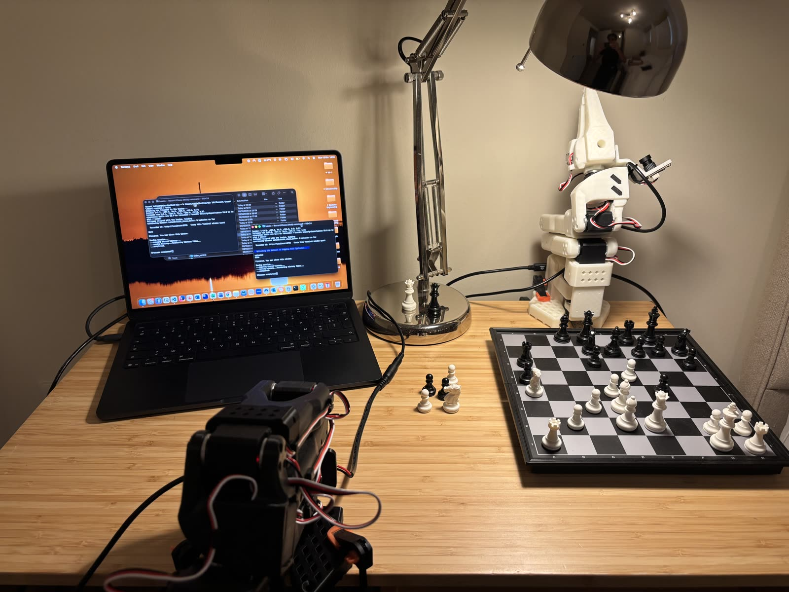
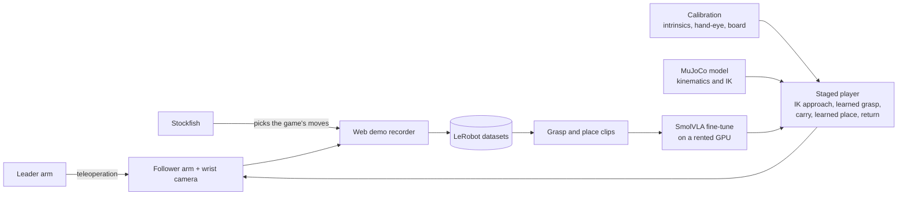
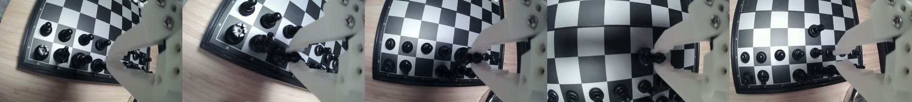
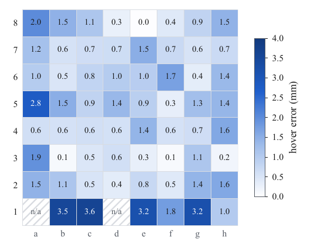

# SO-101 chess

A low-cost [SO-101](https://github.com/TheRobotStudio/SO-ARM100) arm that plays black at chess, with a single wrist
camera as its only view of the board. Stockfish picks the moves, a policy fine-tuned from
[SmolVLA](https://arxiv.org/abs/2506.01844) grasps and places the pieces, and inverse kinematics moves the arm in between.

**Report:** [web](https://hakim-site.pages.dev/posts/so101/) · [PDF](https://hakim-site.pages.dev/posts/so101/so101.pdf) ·
**Datasets and models:** [Hugging Face](https://huggingface.co/LeHak0) · **Author:** Hakim El Ayoubi, UCL

<p align="center">
  
  
</p>
<p align="center"><sub>The rig, with the leader arm used for teleoperation in front, and a game against the arm.
The <a href="https://hakim-site.pages.dev/posts/so101/">web report</a> has the video.</sub></p>

## How it works



Each robot move runs in five stages. Inverse kinematics brings the gripper to a hover above the piece, the learned skill
grasps it, a scripted carry takes it to the target square, the learned skill places it, and a scripted return lifts clear.

<p align="center"></p>
<p align="center"><sub>Wrist-camera frames from one move (bishop f8 to d6), one per stage.</sub></p>

| Folder | Contents |
|---|---|
| `chess_sim/` | MuJoCo model of the rig: kinematics, IK, wrist-camera rendering, a simulated game against Stockfish |
| `calibration/` | camera intrinsics, hand-eye, ready pose, follower gain tests, automatic board calibration |
| `recording/` | web recorder (Stockfish picks the moves, you demonstrate black's with the leader arm) and a grasp drill recorder |
| `goal/` | board pose fitting and cutting episodes into grasp and place clips |
| `train/` | GPU scripts that fine-tune SmolVLA (and ACT as a baseline) and push the models to the Hub |
| `play/` | staged player and web UI, live game against Stockfish, guided game, simulated arm |
| `scripts/` | launchers for all of the above |

## Setup

**Hardware**

- SO-101 follower and leader arms with their power supplies (leader 5 V, follower 12 V)
- A wide-angle wrist camera mounted beside the gripper
- A chessboard with 28 mm squares and Staunton pieces
- A computer for teleoperation and inference (the project used a MacBook Air M4), and a GPU for training

**Software**

```bash
conda create -n so101 python=3.12 -y && conda activate so101
conda install -c conda-forge ffmpeg=7.1.1 -y          # newer ffmpeg broke video decoding in torchcodec
git clone https://github.com/huggingface/lerobot.git third_party/lerobot
cd third_party/lerobot && git checkout e595b79 && git apply ../lerobot.patch && pip install -e ".[smolvla,feetech]" && cd ../..
pip install -r requirements.txt
brew install stockfish                                # or your system's package manager
```

**Connect the arms**

```bash
lerobot-find-port                                     # once per arm, unplugging when asked
cp config.example.yaml config.yaml                    # set the ports, calibration IDs and stockfish_path
lerobot-calibrate --robot.type=so101_follower --robot.port="/dev/tty.usbmodemYOUR_FOLLOWER" --robot.id=follower_arm_1
lerobot-calibrate --teleop.type=so101_leader --teleop.port="/dev/tty.usbmodemYOUR_LEADER" --teleop.id=leader_arm_1
```

Sweep every joint through its full range during `lerobot-calibrate`: an incomplete sweep shifts the joint zero. Keep only
one program connected to the arms at a time.

## Usage

Run everything from the repository root. The simulated runs never open a serial port, so start there:

```bash
scripts/play_dry_run.sh                               # staged player on a simulated arm, UI at http://localhost:8840
scripts/sim_game.sh --auto                            # the MuJoCo twin plays a game against Stockfish
scripts/play_live_game.sh --fake --standin scripted   # live-game page with no arm and no model
```

The repository ships the author's calibration files so that these runs work after cloning. Replace them on your own rig
before running the arm:

```bash
python calibration/camera_calibration.py              # intrinsics, from a flat checkerboard
python calibration/hand_eye.py                        # read its setup instructions first
scripts/play.sh --sync --standin scripted             # idle player; move to ready (H), then in another terminal:
python calibration/auto_board_calib.py --port 8830
```

Record demonstrations, train, and play:

```bash
scripts/record_demos.sh --repo-id YOUR_HF_USERNAME/so101_chess_moves
scripts/record_grasp_drill.sh --repo-id YOUR_HF_USERNAME/so101_chess_grasp
python goal/build_skills_dataset.py plan              # check the clip boundaries, then run with build
bash train/launch_skills.sh B                         # A: action expert only, B: whole model, C: ACT
scripts/play.sh --sync --model-repo YOUR_HF_USERNAME/smolvla_chess_skills_vision
scripts/play_live_game.sh                             # play white against Stockfish and the arm
```

Dataset and model names are set in `goal/build_skills_dataset.py` and `train/launch_*.sh`; change them there to train on
your own data. Offline checks: `python play/check_live_game.py`, and likewise `check_guided_game.py` and `check_astra_skill.py`.

## Results

Measurements, protocols and failure analysis are in the [report](https://hakim-site.pages.dev/posts/so101/).

<p align="center"></p>
<p align="center"><sub>Development evaluations of the configurations tried before the final system.</sub></p>

<p align="center">
  
  
</p>
<p align="center"><sub>Hand-eye reprojection error before and after the joint-zero and checkerboard-order corrections (left), and
hover residuals after automatic board calibration (right).</sub></p>

## Credits

[LeRobot](https://github.com/huggingface/lerobot) and [SmolVLA](https://arxiv.org/abs/2506.01844) (Hugging Face) ·
[SO-ARM100](https://github.com/TheRobotStudio/SO-ARM100) arm and MuJoCo model · [Poly Haven](https://polyhaven.com/a/chess_set)
chess set (CC0) · [Stockfish](https://stockfishchess.org/) · [MuJoCo](https://mujoco.org/) ·
[python-chess](https://python-chess.readthedocs.io/)

## Licence

MIT, see [LICENSE](LICENSE).
