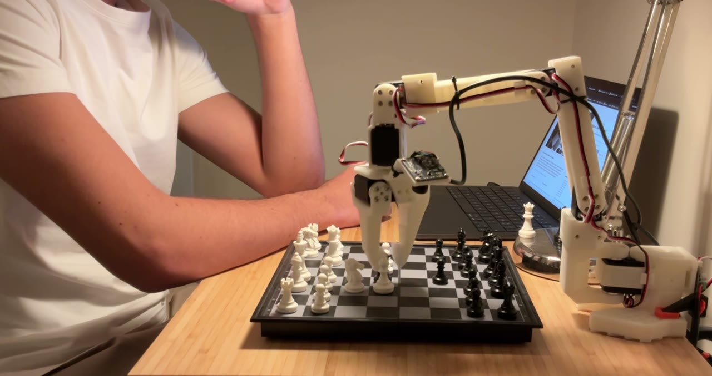
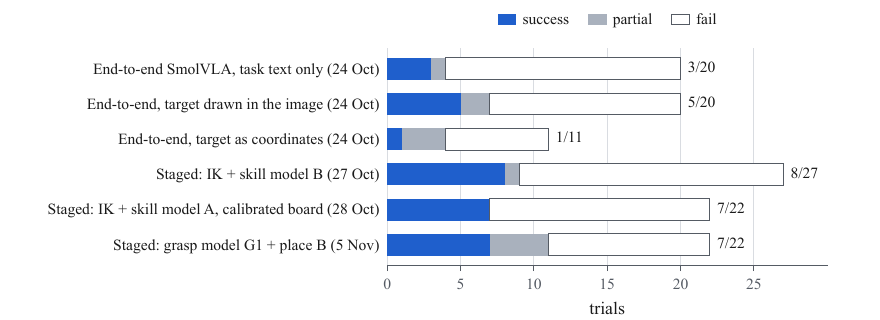
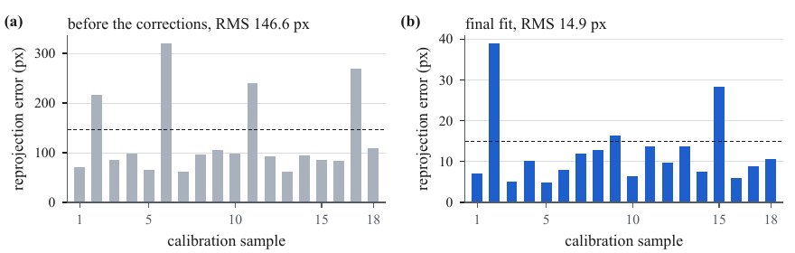
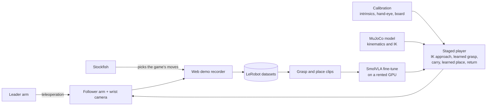

# SO-101 chess

Teaching a low-cost [SO-101](https://github.com/TheRobotStudio/SO-ARM100) arm to play black at chess with a single
wrist camera as its only view of the board. In the system evaluated in the paper, Stockfish selects each move and a
policy fine-tuned from [SmolVLA](https://arxiv.org/abs/2506.01844) grasps and places the piece. The project report describes
the work, its measurements and its limits:

- **Report:** [web version](https://hakim-site.pages.dev/posts/so101/) · [PDF](https://hakim-site.pages.dev/posts/so101/so101.pdf)
- **Author:** Hakim El Ayoubi, University College London

<p align="center">
  
  
</p>

*Left: the rig, with the follower arm beside the board and the leader arm used for teleoperation in front. Right: a
frame from a game against the arm. The [web report](https://hakim-site.pages.dev/posts/so101/) includes videos.*

## Results reported in the paper

The paper follows the project from early end-to-end policies to a calibrated, staged system. In the final evaluated
system, inverse kinematics handles approach, carry and return, while a fine-tuned SmolVLA checkpoint controls the
contact motions for **both grasping and placement**. The results below are the paper's physical measurements on one rig;
they are not benchmarks automatically reproduced by running this source snapshot.

### Final evaluation

The final manipulation checkpoint and controller settings were frozen before the scored evaluation on 10–12 November
2026. Grasping, placement and complete transfers were evaluated in **three separate sets of 200 reset trials**.

| Test | First attempt | Within the reported recovery budget |
|---|---:|---:|
| Grasp the intended piece and retain it through a verification lift | 190/200 (95.0%) | 198/200 (99.0%) |
| Place a correctly held piece upright inside the target square or drop area | 195/200 (97.5%) | 199/200 (99.5%) |
| Complete transfer, including grasp and placement | 184/200 (92.0%) | 194/200 (97.0%) |

An empty grasp received at most two further attempts. Placement recovery used a verified regrasp or repositioning.
The placement test starts with a piece already held, so its rate excludes grasp failures. Do not multiply these
separate rates to infer a new transfer score. The paper gives a Wilson 95% interval of 91.0–97.3% for the first-attempt
grasp result, with a caveat that shared hardware and layouts can correlate failures.

**Games.** Eight short games started from the standard position, with human White and robot Black. Six reached a
legal outcome without manual piece correction; two finished after one correction each. Bounded automatic recoveries
were allowed. Across 127 robot turns and 159 physical transfers, 154 transfers succeeded on the first attempt and 157
without manual help. These game transfers are separate from the 200-transfer test. Ordinary human moves, the
**Move done** signal and resignation confirmation are not counted as manual corrections.

The paper also reports 12 constructed special-move scenarios, four each for en passant, promotion and underpromotion,
with human and robot cases. These functional checks are separate from the game results. The games lasted 7–21 minutes
and contained 7–23 robot turns; they do not establish long-game endurance or a general completion rate.

### What changed before the final evaluation

- **Deployment matched the demonstrations.** The final reported follower settings were `P=24`, `I=0`, `D=32`, matching
  most of the grasp-drill recordings. Skills started from a measured, settled hover rather than while the follower was
  still catching up with the scripted approach.
- **Corrections covered states the policy actually visited.** Another 120 grasp and 100 placement demonstrations
  targeted failed or marginal approaches, crowded/tall pieces, far reaches, off-centre pieces and release timing.
- **Both contact skills were updated together.** The final model continued skill model B for 10,000 steps at a learning
  rate of `1e-5`, batch size 64, with balanced grasp/place sampling and image augmentation. The 7,500-step checkpoint was
  selected using held-out replay and a separate hardware development set.
- **The game supervisor tracked physical progress.** The paper distinguishes watching, reading a human move, choosing
  a reply, executing its transfers and verifying the board before committing the move. An uncertain release, a dropped
  piece or a disturbed neighbour pauses for a board check.

| Training data in the paper | Grasp clips | Placement clips | Total |
|---|---:|---:|---:|
| Clips from full-move demonstrations | 196 | 199 | 395 |
| Additional grasp-only drill | 237 | — | 237 |
| State-targeted corrections | 120 | 100 | 220 |
| Combined pool | 553 | 299 | 852 |
| Training split | 497 | 269 | 766 |
| Validation split | 56 | 30 | 86 |

The original full-move dataset contains 202 teleoperated episodes, 97,850 frames and 54.4 minutes. Episodes and derived
skill clips are different units. The final split groups clips by their source episodes and holds out complete new
correction sessions; final evaluation trials were not added to training.

### Development results and calibration

These earlier configurations motivated the final deployment work; they are not the final checkpoint's results.

| Development configuration | Reported outcome |
|---|---|
| End-to-end SmolVLA, task text only | 3/20 moves |
| End-to-end, target drawn into the camera image | 5/20 |
| End-to-end, target given as coordinates | 1/11 attempts; evaluation stopped early |
| Staged skill model B: scripted approach/carry/return, learned grasp/place | 8/20 distinct moves; all 27 attempts with reruns: 8 successes, 1 partial, 18 failures |
| Staged skill model A after the calibration tour | 7/22 attempts |
| G1 grasp skill paired with the older placement skill | Per-attempt grasp rate rose from 41% to 59%, but complete moves stayed at 7/22 |

The small, partly confounded development comparisons do not establish statistically significant differences between
configurations. In the G1 evaluation, placement lost five of the twelve pieces it received: improving grasping alone
did not improve full transfers.

<p align="center"></p>

Camera intrinsics reached **0.19 px RMS** over 13 checkerboard images. Joint-zero fitting and checkerboard-order
correction reduced hand-eye reprojection error from **146.6 to 14.9 px RMS**. The arm-frame board fit also revealed
about **9% effective scale error across the files**. Automatic calibration gave **1.1 mm mean** and **0.9 mm median**
camera-measured hover residual over 62 squares, with a maximum of 3.6 mm. This internal hover consistency is not the
same as absolute physical placement accuracy: independent checks still found offsets of a few millimetres.

<p align="center"></p>
<p align="center"></p>

The main deployment lessons are to check calibration, actuator tracking and the distribution of skill-start states
before treating every failure as a policy-learning problem. Several factors changed together; the final results do
not isolate their individual contributions. See the [report](https://hakim-site.pages.dev/posts/so101/) for the full
measurements, protocols and failure analysis.

## What this repository currently includes

This source snapshot includes the calibration, recording, dataset-building, training and staged-execution tools, plus
later guided-game and API-vision experiments. **The runnable modes below differ from the paper's evaluated
configuration.**

| Mode | Grasp | Placement and transport | Game control |
|---|---|---|---|
| Live Stockfish game | Selected SmolVLA grasp or combined model | Scripted approach/carry/return; selected learned placement | Legal human moves and live Stockfish replies; operator verifies transfers |
| Learned staged player | Your loaded SmolVLA/ACT skill | Scripted approach/carry/return; learned placement | Individual transfer trials |
| API-vision experiment | GPT or Claude vision backend | Scripted placement with the GPT launcher; see the launcher for other combinations | Individual trials or a guided line |
| Guided game | Recorded leader-arm take when available; otherwise the configured grasp backend | Recorded take or staged scripted execution | A prescribed move line; human White, robot Black |
| Dry run | Scripted stand-in | Simulated follower and scripted stages | No serial connection |

The **live-game page** connects Stockfish to selected learned grasp/place checkpoints. The separate **guided-game**
mode follows a pre-written line and trusts the **Move done/Space** signal by default. The live mode accepts any legal
human move entered as SAN/UCI or selected on the board. Optional camera checking tests source/destination changes;
robot transfers require explicit operator verification. Neither mode provides the paper's full independent board
reading and verification. Recorded replay and API-controlled grasping are separate experiments.

The included guided runner allows ordinary moves and captures, and refuses castling, en passant and promotion. The
broader game-loop and special-move results described in the paper are not exposed by this guided runner. The final
paper checkpoint, final correction datasets and full evaluation recordings are not bundled with this repository.
The live runner adds captures, castling and en passant as pending sequences of learned transfers; promotion and
underpromotion require an explicitly logged manual piece swap, rather than an uncalibrated reserve-tray motion.

## How it works

The paper's hybrid learned-control pipeline is:



1. **Kinematic and visual model** (`chess_sim/`): a MuJoCo model of the rig, with the SO-101 MJCF, the wrist camera, the board and
   real piece dimensions, inverse kinematics, and a simulated game against Stockfish. The twin is used to test poses
   before the arm runs them, render the expected wrist view and replay logged joints.
2. **Calibration** (`calibration/`): camera intrinsics, hand-eye calibration with joint-offset fitting, a search for the
   ready pose that sees the board, follower gain tests, and the automatic board calibration in which the arm measures
   each square with its camera.
3. **Demonstrations** (`recording/`): a web recorder that plays games with Stockfish and records the black moves you
   demonstrate with the leader arm, and a grasp-only drill recorder.
4. **Datasets** (`goal/`): board pose per session, the target marker drawn into the image, and the cutting of game
   episodes into grasp and place clips.
5. **Training** (`train/`): scripts for rented GPU boxes that fine-tune SmolVLA (and ACT as a reference) on the skill
   clips and push the models to the Hugging Face Hub.
6. **Playing** (`play/`): the staged player with its web UI. Inverse kinematics takes the gripper to a hover above the
   piece, the learned skill grasps, a scripted carry moves the piece, the learned skill places, and a scripted return
   lifts clear. A simulated arm runs the same player without hardware. The player can also use a vision-language model
   (Claude, or a GPT vision model) as the grasp skill, with an API key.
7. **Guided game** (`play/guided_game.py`, `play/games/`): a game on the arm, human White and robot Black, that follows
   a pre-written line of moves. Robot moves replay a demonstration recorded with the leader when one exists.


## Setup

### Hardware

- SO-101 follower and leader arms with their power supplies (the leader on 5 V, the follower on 12 V)
- A wrist camera with a wide-angle lens, mounted beside the gripper
- A chessboard with 28 mm squares and Staunton pieces
- A computer for teleoperation and inference (the project used a MacBook Air M4) and a GPU for training

### Software

```bash
conda create -n so101 python=3.12 -y && conda activate so101
conda install -c conda-forge ffmpeg=7.1.1 -y          # newer ffmpeg broke video decoding in torchcodec
git clone https://github.com/huggingface/lerobot.git third_party/lerobot
cd third_party/lerobot && git checkout e595b79 && git apply ../lerobot.patch && pip install -e ".[smolvla,feetech]" && cd ../..
pip install -r requirements.txt                       # MuJoCo, python-chess, OpenCV, ...
brew install stockfish                                # or your system's package manager
```

### Connect the arms

The serial ports differ on every machine. Find yours with LeRobot, then put them in `config.yaml`:

```bash
lerobot-find-port                                     # run it once per arm, unplugging when asked
cp config.example.yaml config.yaml                    # set ports, calibration IDs and stockfish_path
lerobot-calibrate --robot.type=so101_follower --robot.port="/dev/tty.usbmodemYOUR_FOLLOWER" --robot.id=follower_arm_1
lerobot-calibrate --teleop.type=so101_leader --teleop.port="/dev/tty.usbmodemYOUR_LEADER" --teleop.id=leader_arm_1
```

LeRobot sets each joint's zero at the middle of the range swept during its calibration, so sweep every joint through its
full range; an incomplete sweep shifts the zero, and the offset reappears in the hand-eye calibration.

## Usage

Activate the `so101` environment and run everything from the repository root. The scripts in `scripts/` wrap the commands below. Try the simulated versions
first: they never open a serial port.

```bash
# the digital twin playing a game against Stockfish (the script uses mjpython on macOS for the viewer)
scripts/sim_game.sh --auto
scripts/sim_game.sh --headless --plies 6              # no window

# the staged player without hardware: the follower simulated on the twin, a scripted stand-in for the skill
scripts/play_dry_run.sh                               # web UI at http://localhost:8840

# calibration (from a terminal that has camera permission; these commands use the hardware)
python calibration/camera_calibration.py              # intrinsics, from a flat checkerboard
python calibration/hand_eye.py                        # read its setup instructions before running
# Board calibration needs a running, idle player; see the calibration workflow below.

# demonstrations (the follower is aligned to the leader first)
scripts/record_demos.sh --repo-id YOUR_HF_USERNAME/so101_chess_moves
scripts/record_grasp_drill.sh --repo-id YOUR_HF_USERNAME/so101_chess_grasp

# grasp and place clips, then training on a GPU box
python goal/build_skills_dataset.py plan              # inspect clip boundaries and validation split first
python goal/build_skills_dataset.py build             # writes the configured output dataset
bash train/launch_skills.sh B                         # A: action expert only, B: whole model, C: ACT

# the staged player on the arm, and the guided game
scripts/play.sh --sync --model-repo YOUR_HF_USERNAME/smolvla_chess_skills_vision
scripts/play_scripted_game.sh --grasp-repo YOUR_HF_USERNAME/smolvla_chess_grasp
```

The datasets and models of the project are on the Hugging Face Hub under `LeHak0/` and are private, and the scripts use
those names as defaults. To train on your own data, replace the dataset/repository constants in
`goal/build_skills_dataset.py`, the dataset paths in the other builders, and the exported dataset/model names and
validation indices in `train/launch_skills.sh` or `train/launch_grasp.sh`. The launch scripts contain the author's
experiment settings; passing a different recorder `--repo-id` alone does not retarget the rest of the pipeline.
`build` recreates its configured output dataset, so check the destination before running it. These scripts reproduce
the earlier A/B/C and G1/G2 recipes; they are not a one-command reproduction of the paper's final correction run.

A few calibration results of the author's rig are included so that the dry runs work straight after cloning:
`calibration/output/wrist_camera_intrinsics_FINAL.json`, `chess_sim/assets/hand_eye.json`, `goal/board_poses.json`,
`goal/reference_fit.json` and `recording/ready_pose.json`. Replace them by running the calibration on your own rig.

### Calibrate before physical trials

Use only one program connected to the arms at a time. The supplied calibration files are reference geometry for the
author's rig and dry runs, not a calibration of your arm. Read each calibration script's setup instructions, including
checkerboard dimensions, and replace the reference intrinsics, hand-eye transform, board fit and ready pose for your
hardware.

For automatic board calibration, first open the player and leave it idle. The stand-in can open the UI without a
private checkpoint:

```bash
scripts/play.sh --sync --standin scripted              # real-arm UI for calibration; not a learned policy
# In the UI: move to ready (H), then measure/check the board.
# With that player still running, in another terminal:
python calibration/auto_board_calib.py --port 8830
python calibration/auto_board_calib.py --port 8830 --verify-only
```

If the player chooses another port because 8830 is busy, use the port printed in its terminal. The tour moves the arm
through the board; follow its instructions about clearing obstructing pieces. Afterwards inspect the grid and near,
far and corner hovers. A board shift requires re-localisation and verification, and may require a new calibration pass.

The paper's final deployed gain was `P=24`. The live-game launcher defaults to `P=24`; older trial/guided
launchers keep `P=16`. `--follower-p` selects the deployed gain explicitly. Match the deployed
gains to your recordings before comparing results; calibrating the board does not remove a tracking-gain mismatch.
Camera index is selected with each tool's `--camera` argument, rather than a `camera` key in `config.yaml`.

### Live game against Stockfish

```bash
scripts/play_live_game.sh                            # opens the live-game page (default port 8830)
# Hardware-free UI and control-flow check; no model download or serial connection:
scripts/play_live_game.sh --fake --standin scripted --port 8841
```

On the page, enter a **placement/combined model** Hub ID or local model directory and its checkpoint (`final`,
`007500`, etc.). Leave the separate grasp field empty to use that same checkpoint for both skills, or choose a
separate grasp repository and step. Press **Load selected models** and wait for successful loading. Private Hub
models require your existing Hugging Face login. The page displays the loaded repositories/checkpoints, and the
session log includes the resolved local snapshot paths. There is no silent fallback to an older or API model.
`final` means the model published at that repository's root, not proof that it is the paper's selected checkpoint.
An optional `live_model_repo` in `config.yaml` (or `SO101_LIVE_MODEL_REPO`) supplies the initial selection.

1. Move to ready, measure/check the board and hovers, restore all 32 starting pieces, and clear the drop area.
   Acknowledge **Calibration checked**, then start.
2. Wait for **Your turn**, make any legal White move, and enter SAN/UCI or click its source and destination.
   Confirm the physical move yourself, or request the narrower camera change check when both squares are visible.
3. Stockfish chooses a legal Black reply. The selected SmolVLA model controls grasp and placement; calibrated scripted
   paths handle approach, carry and return. After each transfer, check release, destination and neighbours and press
   **Piece released correctly — continue**. The arm stays/returns at ready for your next turn.

Captures remove the victim first; en passant uses the actual pawn square. Castling moves the king and rook as one
pending chess move. The logical move is committed only after every transfer is verified. Promotion and underpromotion
pause for the requested manual piece replacement. Checkmate, stalemate and automatic draws terminate the game;
White resignation and legal draw claims are explicit actions.

A failed transfer pauses without committing the move. Return to ready after inspecting the arm, restore the **current
transfer's** source/destination before retrying, or finish that transfer by hand and acknowledge the assisted recovery.
Earlier verified parts of a capture/castling are retained. Stop (button, Escape or Space outside a text field) holds the arm; it does not roll back physical movement.
Use **Resume after inspection** to recover a stopped game; pending work still requires reconciliation.
Drop slots are tracked without wrapping onto occupied slots; clear and acknowledge the drop area when full.
The live mode disables the older guided-mode blind-release/keep-going behaviour and uses bounded grasp retries.

Events, model selections and physical-transfer results are saved under `play/results/live_games/` (or
`play/results_dryrun/live_games/` with `--fake`), with per-transfer wrist videos/joint logs in the corresponding player
results folder. Operator confirmations and assisted corrections are logged explicitly. This new implementation has
software/simulation checks; its physical game performance has not been evaluated against the paper's results.

### Guided game and recorded replay

See [the guided-game guide](play/games/README.md) for choosing a line, captures, leader-arm recording and replay.
Set up the starting position shown by the UI, return to ready, and start the game. White moves by hand and signals
completion with Space. By default this is a trusted input, not camera verification of the move.

`GAME_TRUST_HUMAN=0` enables local before/after camera checks for a line whose relevant squares are visible:

```bash
GAME_TRUST_HUMAN=0 scripts/play_scripted_game.sh --grasp-repo YOUR_HF_USERNAME/smolvla_chess_grasp
```

Some shipped lines include squares outside the ready camera view. Such a line cannot use this checker for every move.
Leader-arm takes are specific to the script, board state, geometry and calibration. If those change, re-record them.
The runner's handling of a capture without a recorded take may ask you to move it by hand; that is assisted execution.

### Optional API-based grasping

```bash
scripts/play_astra.sh                                # GPT grasp vision + scripted carry/place/return
scripts/play_claude.sh                               # Claude backend; optional anthropic dependency
```

These are later experimental backends, not the paper's fine-tuned SmolVLA evaluation. They require a configured API
key and may incur charges. The GPT launcher reads `OPENAI_API_KEY` or `~/.openai_api_key`; keep credentials out of the
repository. See the backend code and launchers for model and spending settings.

### Offline checks

```bash
python play/check_live_game.py                        # live engine, legal transfer plans and transaction checks
python play/check_guided_game.py                      # guided game logic
python play/check_astra_skill.py                      # vision-model grasp skill, on recorded fixtures and the twin
python chess_sim/tests/run_all.py --skip motion       # the digital twin (the full run with motion takes ~20 min)
```

## Limitations and reproducibility

- The paper's final physical evaluation used one rig over three days. Its eight games are short, and automatic
  recovery and manual assistance must be reported separately.
- Shifted-board results concern roughly 11–22 mm translations **after re-localisation and calibration verification**,
  sometimes with a new calibration pass. They do not establish reliable execution with an outdated correction map.
- Wrist-camera occlusion, crowded back ranks, full reach and gripper geometry remain important sources of error.
  The camera does not observe the entire workspace, so a camera check is not a complete safety system.
- A simulated success checks control flow and model geometry, not physical accuracy or robustness. Repeat physical
  validation on your own setup before relying on a learned policy or recorded replay.
- Hardware-specific fits, original datasets, trained checkpoints and raw evaluation recordings are needed to
  reproduce the reported measurements. The included tools and summary results alone do not supply all of them.

The paper's first end-to-end fine-tune took 1 h 23 min on a rented H100 (about $3.60 from rental to shutdown); the three
skill models cost $9.77 together, and G1 about $1.45. These are historical experiment costs, not a complete project
budget or a quote for reproducing the final model. Inference ran on a MacBook Air M4; training used H100/A100 GPUs.

## Repository layout

| Path | Contents |
|---|---|
| `chess_sim/` | MuJoCo digital twin, kinematics and IK, scene builder, simulated Stockfish game, tests |
| `calibration/` | camera intrinsics, hand-eye, ready pose, alignment to the leader, gain tests, automatic board calibration |
| `recording/` | web demo recorder and grasp drill recorder |
| `goal/` | board pose fitting, target marker projection, skill-clip dataset builders |
| `train/` | GPU training scripts |
| `play/` | live Stockfish game/model picker, staged player and UI, staged executor, board vision, simulated arm, guided game, vision-model grasp skills, 20-move evaluation set |
| `play/games/` | the pre-written game lines for the guided game, and the script that makes them |
| `scripts/` | launchers for the steps above |
| `so101_config.py`, `config.example.yaml` | machine-specific settings: serial ports, motor calibration names, Stockfish path |
| `third_party/lerobot.patch` | two local changes to LeRobot at commit `e595b79` (recorder and keyboard input) |
| `docs/figures/` | figures from the report |

## Credits

- [LeRobot](https://github.com/huggingface/lerobot) and [SmolVLA](https://arxiv.org/abs/2506.01844) (Hugging Face)
- SO-101 arm and its MuJoCo model: [TheRobotStudio/SO-ARM100](https://github.com/TheRobotStudio/SO-ARM100)
- Staunton chess set meshes: [Poly Haven](https://polyhaven.com/a/chess_set), CC0
- [Stockfish](https://stockfishchess.org/), [MuJoCo](https://mujoco.org/), [python-chess](https://python-chess.readthedocs.io/)

## Licence

MIT, see [LICENSE](LICENSE).
